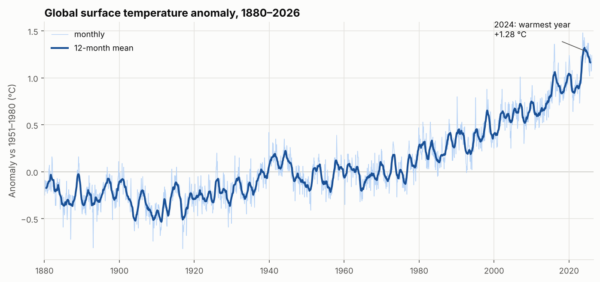
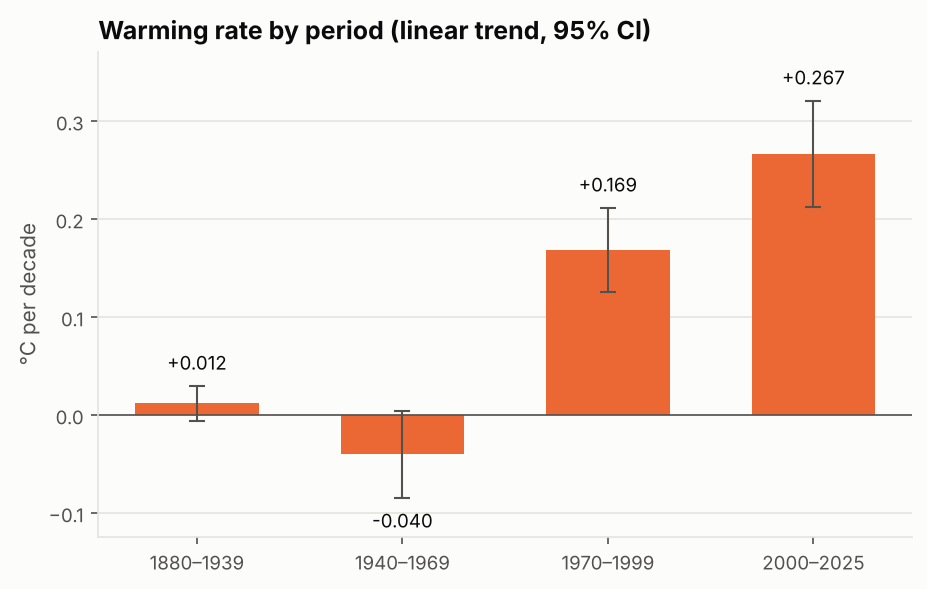
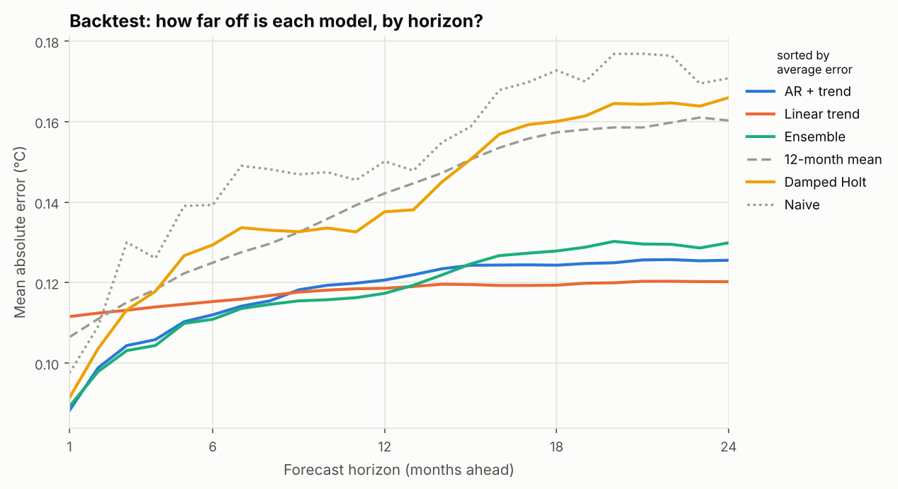
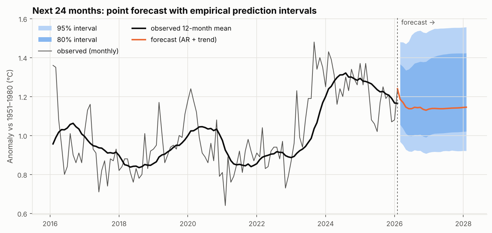

# 全球气温时间序列分析与预测 · Global Temperature Forecast


基于 NASA GISTEMP v4 的全球月均气温距平数据（1880 年 1 月 – 2026 年 2 月，共 1,754 个月），完成**长期趋势分析 → 6 种预测模型的滚动回测 → 未来 24 个月预测与经验预测区间**的完整时间序列项目。

所有模型只用 numpy / scipy / scikit-learn 手写实现，不依赖专门的时间序列库，便于理解每个模型的原理。



## 主要发现

| | |
| --- | --- |
| 最热年份 | **2024 年**，比 1880–1900 平均高约 **1.5 °C**；最热的 10 个年份全部在 2010 年之后 |
| 升温在加速 | 1970–1999 年 +0.17 °C/十年 → **2000–2025 年 +0.27 °C/十年** |
| 预测模型 | 在 291 个预测起点的回测中，AR + 趋势模型平均误差 0.118 °C，比朴素预测低 22% |
| 系统性低估 | 所有模型在回测中都偏低：基于历史趋势的方法跟不上升温的加速 |
| 2026 年展望 | 全年平均距平预计约 **+1.15 °C**，按点预测将位列有记录以来第 4 热 |



不同模型擅长不同的预测步长：自回归模型能利用最近几个月的偏离（如厄尔尼诺），短期最准；预测得越远，越依赖对长期趋势的把握。





👉 完整分析见 **[outputs/report.md](outputs/report.md)**。

## 快速开始

```bash
git clone https://github.com/Zzzxy22/global-temperature-forecast.git
cd global-temperature-forecast

python -m venv .venv
source .venv/bin/activate        # Windows: .venv\Scripts\activate
pip install -r requirements.txt

PYTHONPATH=src python -m tempcast
```

Windows PowerShell 下把最后一行换成：

```powershell
$env:PYTHONPATH="src"; python -m tempcast
```

也可以 `pip install -e .` 安装后直接运行 `tempcast`。

### 用最新数据重新预测

仓库自带的数据截至 2026 年 2 月。NASA 每月中旬更新一次，加上 `--update` 即可下载最新数据并重新跑完整分析：

```bash
PYTHONPATH=src python -m tempcast --update
```

也可以手动从 [NASA GISTEMP](https://data.giss.nasa.gov/gistemp/tabledata_v4/GLB.Ts+dSST.csv) 下载，再用 `--csv 文件路径` 指定。

| 参数 | 说明 | 默认值 |
| --- | --- | --- |
| `--csv PATH` | GISTEMP 格式的 CSV | `data/GLB.Ts+dSST.csv` |
| `--out DIR` | 输出目录 | `outputs/` |
| `--horizon N` | 预测未来多少个月 | `24` |
| `--update` | 先从 NASA 下载最新数据 | 关闭 |

### 运行测试

```bash
python -m pytest -q
```

## 方法

**模型**（`src/tempcast/models.py`）

| 模型 | 思路 |
| --- | --- |
| Naive | 未来每个月都等于最后一个观测值（基线） |
| 12-month mean | 未来等于最近 12 个月平均（基线） |
| Linear trend | 对最近 30 年做直线回归并外推 |
| Damped Holt | 阻尼趋势指数平滑，用 L-BFGS-B 最小化一步预测误差来估计参数 |
| AR + trend | 带线性趋势的 12 阶自回归，Ridge 估计，递推生成多步预测 |
| Ensemble | 上面三个非基线模型的平均 |

**评估：滚动起点回测**（`src/tempcast/backtest.py`）：从 2000 年起每个月设一个预测起点，只用起点之前的数据训练，预测之后 1–24 个月。这模拟了真实的预测场景，避免用到未来信息。

**预测区间**：不假设误差服从正态分布，而是取回测中同一预测步长（合并相邻 ±2 步）误差的经验分位数，叠加到点预测上。

## 项目结构

```
global-temperature-forecast/
├── data/GLB.Ts+dSST.csv        # NASA GISTEMP v4 原始数据
├── src/tempcast/
│   ├── data.py                 # 解析 GISTEMP 表格
│   ├── trend.py                # 升温速率、最热年份、年代平均
│   ├── models.py               # 6 个预测模型
│   ├── backtest.py             # 滚动回测、误差评分、经验预测区间
│   ├── plots.py                # 图表（色盲友好配色）
│   ├── report.py               # 生成 Markdown 报告
│   └── __main__.py             # 命令行入口
├── tests/                      # pytest：数据解析、模型、回测、端到端
├── outputs/                    # 报告、图表、预测结果 CSV
└── .github/workflows/ci.yml    # GitHub Actions 自动测试
```

## 数据来源

GISTEMP Team, 2026: *GISS Surface Temperature Analysis (GISTEMP), version 4*. NASA Goddard Institute for Space Studies. https://data.giss.nasa.gov/gistemp/

Lenssen, N., et al. (2024). A NASA GISTEMPv4 observational uncertainty ensemble. *Journal of Geophysical Research: Atmospheres*, 129, e2023JD040179.

## 局限性

统计模型只能外推历史规律，无法预知火山爆发或厄尔尼诺的突然转换。长期气候预测应以物理气候模式为准，本项目用于学习时间序列分析方法。

## License

[MIT](LICENSE)
