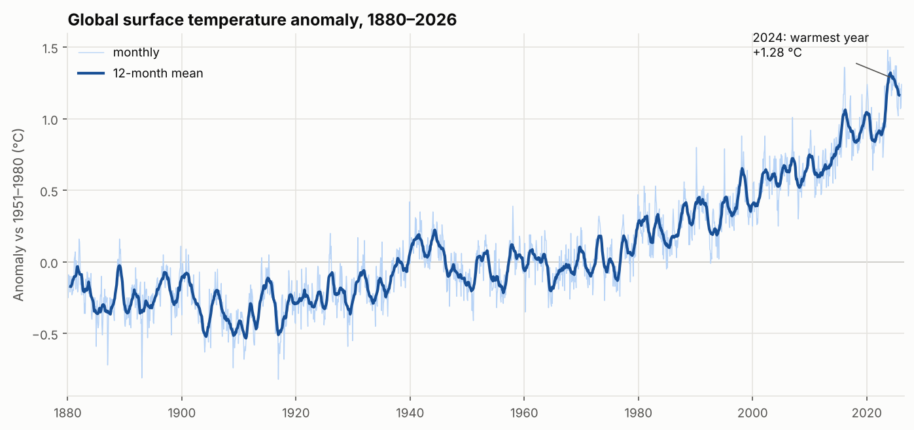
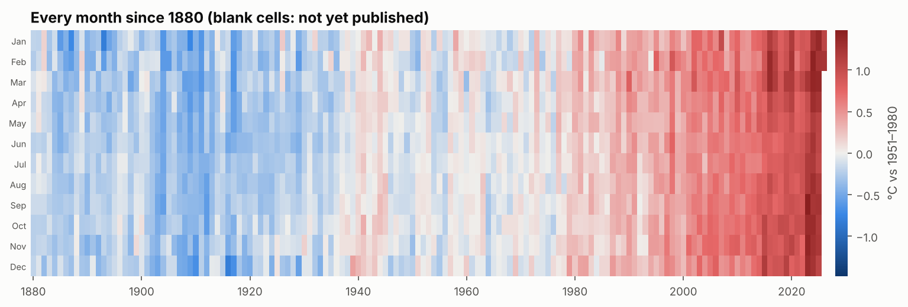
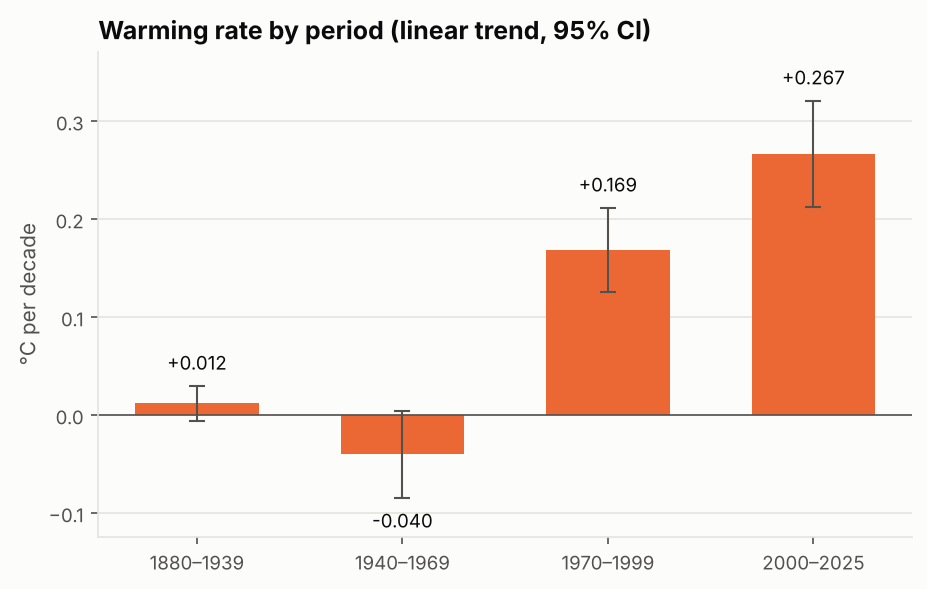
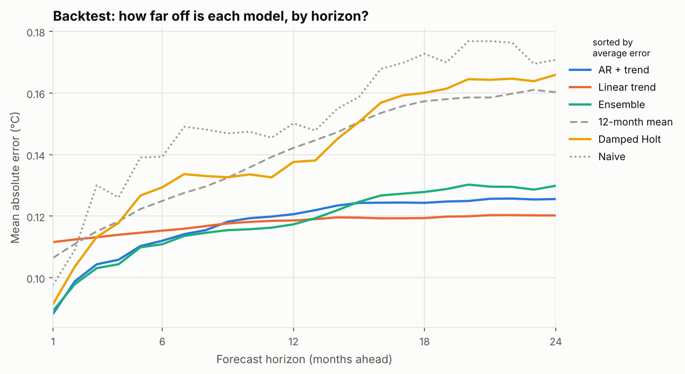
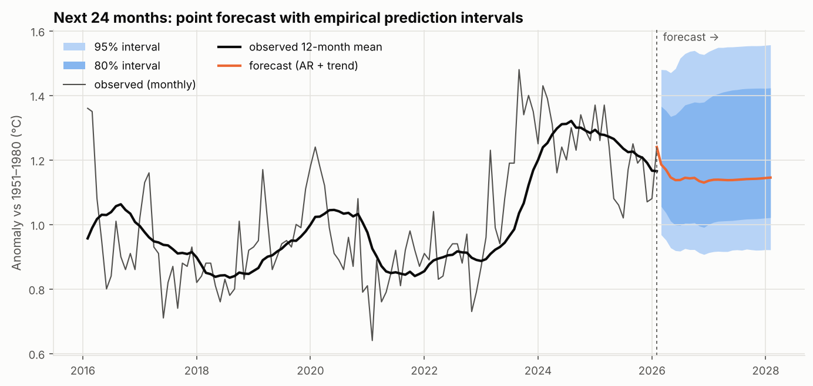

# 全球气温时间序列分析与预测

> 自动生成于 2026-11-06 · 数据：NASA GISTEMP v4 全球陆地-海洋温度距平（基准期 1951–1980）

## 1. 核心结论

- 数据覆盖 1880 年 1 月 至 **2026 年 2 月**，共 1,754 个月。
- **2024 年是有记录以来最热的一年**，年均距平 +1.28 °C，比 1880–1900 年平均高约 **1.51 °C**；最热的 10 个年份中有 **10** 个出现在 2010 年之后。
- 升温在加速：1880–1939 约 +0.012 °C/十年，**2000–2025 达到 +0.267 °C/十年**（95% 置信区间 +0.213 ~ +0.321）。
- 在 291 个预测起点的滚动回测中，**AR + trend** 平均误差最小（MAE 0.118 °C），比"维持上月不变"的朴素预测低 22%。
- 所有模型的平均偏差都为正，说明**回测期内实际气温系统性地高于各模型的预测**：基于历史趋势的方法会低估升温的加速。
- 结合已观测的 2 个月，**2026 年**全年平均距平预计约 **+1.15 °C**（约 80% 区间 +1.03 ~ +1.33 °C），按点预测将位列有记录以来第 **4** 热。

## 2. 数据

- 来源：NASA 戈达德空间研究所 GISTEMP v4（`data/GLB.Ts+dSST.csv`），数值为相对 1951–1980 年平均的月均气温距平（°C）。
- 处理：把"年 × 月"宽表展开为月度序列；`***` 记为缺失，去掉末尾尚未发布的月份。年平均只统计 12 个月完整的年份。
- 气温距平已去除季节循环，因此序列的主要成分是**长期趋势**和**数月到数年尺度的波动**（如厄尔尼诺/拉尼娜）。

## 3. 长期趋势

各时期的线性升温速率：

| 时期 | 升温速率（°C/十年） | 95% 置信区间 | R² |
| --- | --- | --- | --- |
| 1880–1939 | +0.012 | -0.006 ~ +0.030 | 0.03 |
| 1940–1969 | -0.040 | -0.084 ~ +0.004 | 0.11 |
| 1970–1999 | +0.169 | +0.126 ~ +0.212 | 0.70 |
| 2000–2025 | +0.267 | +0.213 ~ +0.321 | 0.81 |

20 世纪中叶升温基本停滞（甚至略有下降），1970 年后明显加快，2000 年以来又进一步提速。各年代平均：1980s 为 +0.24 °C、1990s 为 +0.38 °C、2000s 为 +0.58 °C、2010s 为 +0.80 °C、2020s 为 +1.06 °C。

> 置信区间由普通最小二乘给出。年际自相关会使标准误偏小，实际不确定性比表中略大。

有记录以来最热的 10 个年份：

| 排名 | 年份 | 距平（°C） |
| --- | --- | --- |
| 1 | 2024 | +1.28 |
| 2 | 2025 | +1.19 |
| 3 | 2023 | +1.17 |
| 4 | 2016 | +1.01 |
| 5 | 2020 | +1.01 |
| 6 | 2019 | +0.98 |
| 7 | 2017 | +0.91 |
| 8 | 2015 | +0.89 |
| 9 | 2022 | +0.89 |
| 10 | 2021 | +0.85 |

## 4. 预测模型与回测

比较了 6 种模型：

| 模型 | 思路 |
| --- | --- |
| Naive | 未来每个月都等于最后一个观测值 |
| 12-month mean | 未来等于最近 12 个月的平均 |
| Linear trend | 对最近 30 年做直线回归并外推 |
| Damped Holt | 阻尼趋势指数平滑，参数通过最小化一步预测误差估计 |
| AR + trend | 带线性趋势的 12 阶自回归（Ridge 估计，递推多步预测） |
| Ensemble | Linear trend、Damped Holt、AR + trend 三者平均 |

**回测方法（滚动起点）**：从 2000 年 1 月起每个月设一个预测起点，只用起点之前的数据训练，预测之后 1–24 个月，再与真实值比较。这模拟了"站在过去某一时刻做预测"的真实情境，不会用到未来信息。

| 模型 | 平均 MAE | RMSE | 1 个月 | 12 个月 | 24 个月 | 平均偏差 |
| --- | --- | --- | --- | --- | --- | --- |
| AR + trend | 0.118 | 0.158 | 0.088 | 0.121 | 0.126 | +0.047 |
| Linear trend | 0.118 | 0.157 | 0.112 | 0.119 | 0.120 | +0.042 |
| Ensemble | 0.118 | 0.158 | 0.089 | 0.117 | 0.130 | +0.043 |
| 12-month mean | 0.140 | 0.182 | 0.106 | 0.142 | 0.160 | +0.054 |
| Damped Holt | 0.141 | 0.183 | 0.091 | 0.138 | 0.166 | +0.039 |
| Naive | 0.152 | 0.197 | 0.098 | 0.150 | 0.171 | +0.036 |

- **短期（1–6 个月）**：自回归和指数平滑能利用最近几个月的偏离（如正在发生的厄尔尼诺），表现最好。
- **长期（12 个月以上）**：短期波动的信息逐渐失效，误差主要取决于对长期趋势的把握，线性趋势类模型更稳。
- AR + trend 与第二名 Linear trend 的平均误差仅相差 0.000 °C，差距在回测噪声范围内，可视为表现相当。

## 5. 未来 24 个月预测

使用 **AR + trend** 在全部数据上重新训练。预测区间**不假设误差服从正态分布**，而是直接取回测中各预测步长误差的经验分位数，因此越往后区间越宽。由于回测中模型通常偏低，区间也**向上方倾斜**（上限离点预测更远）。在回测样本中，80% 区间的实际覆盖率为 80%（样本内评估，偏乐观）。

| 月份 | 点预测（°C） | 80% 区间 | 95% 区间 |
| --- | --- | --- | --- |
| 2026-03 | +1.19 | +1.06 ~ +1.37 | +0.97 ~ +1.48 |
| 2026-08 | +1.14 | +1.00 ~ +1.37 | +0.92 ~ +1.53 |
| 2027-02 | +1.14 | +1.01 ~ +1.40 | +0.92 ~ +1.54 |
| 2027-08 | +1.14 | +1.02 ~ +1.42 | +0.92 ~ +1.55 |
| 2028-02 | +1.15 | +1.02 ~ +1.42 | +0.92 ~ +1.56 |

按日历年汇总：

| 年份 | 已观测月份 | 预测年均距平（°C） | 约 80% 区间 | 历史排名（点预测） |
| --- | --- | --- | --- | --- |
| 2026 | 2 | +1.15 | +1.03 ~ +1.33 | 第 4 |
| 2027 | 0 | +1.14 | +1.01 ~ +1.41 | 第 4 |

## 6. 局限性

- 统计模型只能外推历史规律，**无法预知**火山爆发、厄尔尼诺突然转换等事件；物理气候模式（如 CMIP）才是长期气候预测的主要工具。
- 回测期（2000 年至今）内升温在加速，导致所有模型存在正偏差；如果加速继续，预测很可能偏低。
- "1880–1900 平均"只是工业化前水平的粗略近似（《巴黎协定》通常使用 1850–1900），不同数据集的数值也会有差异。
- 本仓库附带的数据截至 2026 年 2 月。下载 NASA 最新数据后重新运行，即可得到更新的分析与预测（见 README）。
